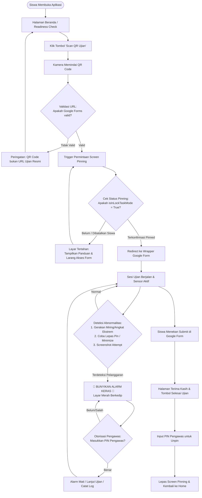

# Product Requirements Document (PRD)
## Secure Exam Web Wrapper (Aplikasi Ujian Anti-Contek)

---

| Dokumen | Keterangan |
| :--- | :--- |
| **Nama Proyek** | Exam Shield / Secure Exam Wrapper |
| **Versi** | 1.0.0 (Draf Spesifikasi Produk) |
| **Target Platform** | Android (Flutter + Native Kotlin/Java MethodChannel) |
| **Status** | In Review / Brainstorming |
| **Target Rilis** | Q4 2026 / Semester Ujian Sekolah |

---

## 1. Latar Belakang & Masalah (Problem Statement)

Dalam pelaksanaan ujian berbasis digital di sekolah atau institusi pendidikan saat ini, banyak institusi memilih menggunakan **Google Forms** karena kemudahan pembuatan soal, penilaian otomatis, dan fleksibilitasnya. Namun, pelaksanaan ujian melalui browser standar (Chrome, Safari, dll.) di smartphone siswa memiliki celah kecurangan yang sangat tinggi:

1. **Mudah Berpindah Aplikasi**: Siswa dapat dengan mudah melakukan split-screen, membuka browser lain, mencari jawaban di Google/ChatGPT, atau membuka aplikasi chatting (WhatsApp, Telegram) untuk berbagi jawaban.
2. **Screen Capture & Screen Sharing**: Siswa dapat melakukan screenshot atau screen recording untuk membagikan soal ke pihak luar.
3. **Pergerakan Tersembunyi**: Siswa dapat memiringkan HP ke arah teman, menaruh HP di bawah meja/laci, atau mengangkat HP untuk mengambil foto soal/contekan.
4. **Kelemahan Kiosk Browser Biasa**: Banyak aplikasi web wrapper ujian gratis yang mudah di-bypass karena siswa bisa membatalkan dialog *Screen Pinning* (pada Android versi lama atau vendor kustom seperti MIUI, ColorOS, OneUI) dan langsung masuk ke soal tanpa perlindungan aktif.

---

## 2. Tujuan Produk (Goals) & Batasan (Non-Goals)

### 2.1 Goals
- **Wrapper Google Forms yang Aman**: Membungkus antarmuka Google Forms dalam lingkungan terkunci (*locked kiosk mode*) tanpa mengubah format form asli.
- **Validasi Ketat Screen Pinning**: Memastikan aplikasi **tidak boleh** mengakses form ujian sebelum status Screen Pinning (*Lock Task Mode*) benar-benar aktif dan diverifikasi oleh sistem operasi.
- **Deteksi Pergerakan Abnormal**: Memanfaatkan sensor fisik perangkat (akselerometer/giroskop) untuk mendeteksi gelagat fisik siswa yang mencurigakan (misalnya HP diangkat drastis, dimiringkan ke teman, atau diguncang).
- **Alarm Suara Seketika**: Membunyikan alarm peringatan di ruangan jika terjadi pelanggaran atau gerakan abnormal agar pengawas dapat langsung mengidentifikasi siswa yang bersangkutan.
- **Kemudahan Akses**: Siswa cukup membuka aplikasi dan memindai QR Code di papan tulis/meja untuk memulai ujian.

### 2.2 Non-Goals
- Aplikasi tidak bertindak sebagai pembuat soal (CMS) mandiri; Google Forms tetap menjadi penyedia konten dan pengumpul jawaban.
- Aplikasi tidak menggantikan peran pengawas manusia secara total, melainkan menjadi alat bantu pencegah dan deteksi dini di ruang ujian.
- Tidak memerlukan infrastruktur server backend rumit untuk tahap awal (aplikasi bersifat *standalone client* dengan konfigurasi ujian melalui QR Code).

---

## 3. Profil Pengguna (User Personas)

1. **Siswa / Peserta Ujian**
   - Menggunakan smartphone Android masing-masing (*Bring Your Own Device - BYOD*).
   - Membutuhkan antarmuka yang sederhana: buka aplikasi $\rightarrow$ scan QR $\rightarrow$ konfirmasi pin $\rightarrow$ kerjakan form tanpa gangguan.
2. **Guru / Pengawas Ujian**
   - Membutuhkan kepastian bahwa tidak ada siswa yang membuka tab lain atau mencontek.
   - Mengontrol ruangan melalui alarm fisik yang berbunyi jika ada siswa yang melanggar.
   - Memiliki kode otorisasi / PIN Pengawas untuk membuka kunci atau mereset alarm jika terjadi situasi darurat/salah deteksi.

---

## 4. Alur Kerja Pengguna (User Journey & Flowchart)

---

## 5. Spesifikasi Fitur Terperinci (Functional Requirements)

### 5.1 FR-1: Halaman Beranda & QR Code Scanner
- **Tampilan Beranda**:
  - Mengadopsi desain Notion-style yang bersih, tenang, dan minim distraksi (merujuk pada `Design.md`).
  - Menampilkan status kesiapan perangkat:
    - Izin Kamera (Diberikan / Belum).
    - Status Baterai (Minimal 20% disarankan).
    - Status Koneksi Internet (Wi-Fi / Seluler aktif).
  - Tombol Utama: **"Scan QR Ujian"** (Accent color: Notion Blue `#0075de`).
- **QR Code Scanner**:
  - Menggunakan modul kamera bawaan yang cepat membaca kode QR.
  - Memiliki tombol toggle Flash/Senter untuk ruangan dengan pencahayaan redup.
  - **URL Sanitization & Validation**:
    - Memeriksa URL hasil scan.
    - Hanya menerima domain yang telah diizinkan: `forms.gle`, `docs.google.com/forms`, atau domain formulir sekolah yang didaftarkan.
    - Menolak URL acak, phishing, atau tautan berbahaya.

### 5.2 FR-2: Mesin Penegak Screen Pinning (Lock Task Mode Engine)
- **Mekanisme Permintaan Pin**:
  - Setelah URL valid ditemukan, aplikasi memanggil perintah native Android `startLockTask()` via Flutter MethodChannel.
- **Pengecekan Status Ketat (The Gatekeeper)**:
  - **Larangan Redirect Prematur**: Aplikasi dilarang keras membuka halaman webview form sebelum status pin aktif.
  - Native MethodChannel mengembalikan status `ActivityManager.isInLockTaskMode()` (atau `LOCK_TASK_MODE_PINNED` / `LOCK_TASK_MODE_LOCKED`).
  - **Skenario Android Lama / ROM Vendor (MIUI, Vivo, Oppo, Realme)**:
    - Pada sebagian ROM, dialog sistem Android bisa di-cancel oleh siswa atau tombol "Batal" ditekan.
    - Jika status bernilai `false`, antarmuka akan menampilkan layar peringatan: *"Aplikasi belum disematkan (pinned). Anda wajib menyematkan aplikasi untuk memulai ujian."* beserta panduan tombol fisik.
    - Terdapat tombol *"Coba Sematkan Lagi"*. Form tetap terkunci rapat hingga status bernilai `true`.

### 5.3 FR-3: Wrapper Google Form (Secure WebView)
- **Komponen WebView Terisolasi**:
  - Memuat Google Form dengan performa tinggi.
  - Navigasi terkunci: Siswa tidak bisa memasukkan URL lain, tidak ada address bar, dan tidak ada navigation bar.
- **Hardening Keamanan WebView**:
  - `FLAG_SECURE`: Window Android diproteksi dari screenshot, screen recorder, dan task switcher preview (layar menjadi hitam jika dicoba direkam).
  - Nonaktifkan seleksi teks (`user-select: none`), klik kanan / long-press context menu, dan drag-and-drop.
  - Blokir pembukaan link eksternal (`target="_blank"` atau `window.open()` dipotong dan ditolak).
  - Cache & Cookie Management: Memastikan akun Google siswa dapat login jika formulir mewajibkan login akun sekolah (@sekolah.sch.id).

### 5.4 FR-4: Mesin Deteksi Pergerakan Abnormal (Motion Anti-Cheat Engine)
- **Sumber Data Sensor**:
  - Menggunakan sensor bawaan smartphone: **Akselerometer (Accelerometer)** dan **Giroskop (Gyroscope)**.
- **Parameter Kalibrasi Posisi Wajar (Baseline Mengerjakan Ujian)**:
  - Saat mulai ujian, aplikasi mengambil kalibrasi baseline (misal HP ditaruh di meja dengan sudut kemiringan $0^\circ - 35^\circ$).
- **Kategori Pergerakan Abnormal**:
  1. **Tilt / Kemiringan Ekstrem**: HP dimiringkan lebih dari batas wajar ($> 60^\circ$ ke samping kiri/kanan), indikasi memperlihatkan layar ke teman sebangku.
  2. **Sudut Angkat Vertikal**: HP diangkat tegak lurus ($> 75^\circ - 90^\circ$) setara ketinggian mata/dada, indikasi memotret soal atau mengangkat HP di atas meja.
  3. **Guncangan Mendadak (Sudden Shake / Jerk)**: Lonjakan akselerasi tiba-tiba ($> 2.5g$), indikasi menyembunyikan HP ke dalam kolong meja atau mengoper perangkat.
  4. **Pembalikan HP (Flip Down)**: HP dibalik dengan layar menghadap ke bawah meja.
- **Filter Toleransi (Debouncing & Smoothing)**:
  - Mencegah *false alarm* akibat sentuhan tangan biasa dengan menerapkan buffer waktu (misal: pergerakan miring harus bertahan selama $> 1.5$ detik atau lonjakan tajam berturut-turut).

### 5.5 FR-5: Sistem Alarm & Penanganan Pelanggaran
- **Pemicu Alarm**:
  - Terdeteksi pergerakan abnormal dari sensor.
  - Terdeteksi pelepasan screen pinning (jika siswa menekan kombinasi tombol unpin Android).
  - Aplikasi kehilangan fokus (`AppLifecycleState.paused` / `inactive`).
- **Respon Alarm**:
  - **Suara Sirene / Alarm Keras**: Memutar audio alarm khusus pada volume maksimal (mengabaikan mode senyap/silent mode perangkat).
  - **Visual Alert**: Layar berkedip merah dan menampilkan pesan jelas: *"PERINGATAN: Terdeteksi Pergerakan Abnormal! Segera letakkan perangkat Anda di atas meja."*
  - **Vibrasi Intensif**: Perangkat bergetar terus-menerus selama alarm aktif.
- **Pelepasan / Reset Alarm**:
  - Alarm hanya dapat dimatikan dengan memasukkan **PIN Pengawas (Supervisor Master PIN)** oleh guru yang mendatangi meja siswa.
  - Setiap insiden alarm dicatat dalam log sesi lokal (timestamp, jenis anomali, durasi).

### 5.6 FR-6: Pengawas Mode & Selesai Ujian
- **PIN Pengawas Default / Konfigurasi**:
  - Guru dapat menentukan PIN Pengawas sebelum ujian atau menggunakan default PIN institusi.
- **Alur Keluar Aplikasi**:
  - Setelah siswa menekan tombol "Kirim / Submit" pada Google Form, muncul tombol "Selesai Ujian".
  - Untuk melepas Screen Pinning (`stopLockTask()`) dan keluar dari aplikasi, siswa wajib meminta pengawas memasukkan PIN Pengawas.

---

## 6. Kebutuhan Non-Fungsional (Non-Functional Requirements)

| Kategori | Parameter & Spesifikasi |
| :--- | :--- |
| **Kinerja & Latensi** | - Latensi deteksi sensor ke pemicu alarm $< 500$ ms. - Pengambilan sampel sensor diatur hemat daya (*UI / Normal sampling rate* $\approx 20-50$ Hz). |
| **Keandalan (Reliability)** | - Form submission tidak boleh hilang jika terjadi guncangan atau alarm berbunyi. - State WebView harus tetap terjaga tanpa reload yang menghilangkan jawaban siswa. |
| **Kompatibilitas** | - Mendukung Android 7.0 (Nougat / API 24) hingga Android 14+. - Penyesuaian khusus untuk vendor ROM (MIUI/HyperOS, OneUI, ColorOS, FuntouchOS). |
| **Keamanan Sistem** | - `FLAG_SECURE` aktif permanen selama sesi ujian. - Deteksi USB Debugging dan Developer Options (opsional: peringatan jika aktif). |
| **Ketahanan Jaringan** | - Jika koneksi internet terputus saat pengerjaan, WebView menampilkan banner offline ramah pengguna tanpa merusak isi form. |

---

## 7. Desain & Arsitektur Teknis

### 7.1 Tech Stack
- **Framework**: Flutter (Dart ^3.13.5).
- **Architecture**: Clean Architecture / Feature-first (Presentation, Domain, Data).
- **State Management**: BLoC / Riverpod / ChangeNotifier.
- **Native Android Layer**:
  - Kotlin / Java MethodChannel untuk:
    1. `startLockTask()` & `stopLockTask()`.
    2. `ActivityManager.isInLockTaskMode()`.
    3. `WindowManager.LayoutParams.FLAG_SECURE`.
    4. Override volume multimedia untuk suara alarm.
- **Libraries Rekomendasi**:
  - `mobile_scanner` / `qr_code_scanner`: Pembaca QR code.
  - `webview_flutter`: Wrapper Google Forms.
  - `sensors_plus`: Pembaca akselerometer dan giroskop.
  - `audioplayers` / `just_audio`: Pemutar suara alarm.

---

## 8. Panduan Desain UI/UX (Sesuai `Design.md`)

- **Palet Warna**:
  - Background: White `#ffffff` (Light) / Warm Dark `#191919`.
  - Aksent Interaktif: Notion Blue `#0075de` untuk tombol utama ("Scan QR", "Konfirmasi").
  - Status Bahaya / Alarm: Danger Orange-Red `#dd5b00` (atau Crimson Red saat alarm aktif).
  - Garis Tepi: Whisper border (`rgba(0,0,0,0.1)`).
- **Tipografi**:
  - Font Inter dengan tracking agresif pada heading dan netral pada teks deskriptif.
- **Tampilan Khusus**:
  - Halaman Pin Gatekeeper: Bersih, menampilkan ilustrasi animasi cara menyematkan aplikasi sesuai merk smartphone.
  - Halaman Ujian: Edge-to-edge fullscreen, menyembunyikan status bar dan gesture bar.

---

## 9. Analisis Risiko & Mitigasi (Edge Cases)

| Skenario Risiko | Dampak | Mitigasi Solusi |
| :--- | :--- | :--- |
| **Siswa membatalkan dialog Pinning di Android lama** | Siswa bisa bebas membuka aplikasi lain | **Gatekeeper Barrier**: Aplikasi tidak pernah membuka WebView sebelum `isInLockTaskMode == true`. Layar terkunci di halaman peringatan. |
| **Siswa menekan tombol fisik unpin saat ujian** | Layar terlepas dari mode pin | Begitu status `isInLockTaskMode` berubah menjadi `false`, aplikasi langsung membunyikan sirene alarm keras dan menggelapkan layar. |
| **False Alarm (Tangan siswa bergetar atau sengaja menyenggol meja)** | Mengganggu konsentrasi ruang ujian | Terapkan filter ambang batas (*threshold filter*) dan waktu konfirmasi ($1.5$ detik stabil miring sebelum alarm berbunyi). |
| **Siswa mengecilkan volume HP sebelum ujian** | Alarm tidak terdengar saat berbunyi | Channel native Android memaksa stream `STREAM_ALARM` atau `STREAM_MUSIC` ke volume $100\%$ saat alarm dipicu. |
| **Baterai HP habis di tengah ujian** | Jawaban Google Form belum tersimpan | Peringatan pra-ujian di halaman beranda jika baterai $< 20\%$. |

---

## 10. Pertanyaan Klarifikasi & Opsi Desain Lanjutan

Untuk menyempurnakan implementasi teknis berikutnya, ada beberapa detail operasional yang dapat kita sepakati bersama:

1. **Sensitivitas Sensor Gerakan**:
   - Apakah Anda menginginkan pengaturan sensitivitas (Rendah / Sedang / Tinggi) yang bisa disetel oleh guru melalui menu pengaturan pengawas sebelum ujian dimulai?
2. **Kamera Depan (Face Presence Detection)**:
   - Selain sensor gerak HP, apakah di masa mendatang perlu ditambahkan deteksi wajah via kamera depan (misal mendeteksi jika siswa menoleh ke samping lebih dari 5 detik)?
3. **Mekanisme PIN Pengawas**:
   - Apakah PIN Pengawas cukup berupa PIN angka statis (misal 6 digit yang ditentukan di awal), atau disematkan di dalam QR Code ujian bersama dengan URL Google Form?
